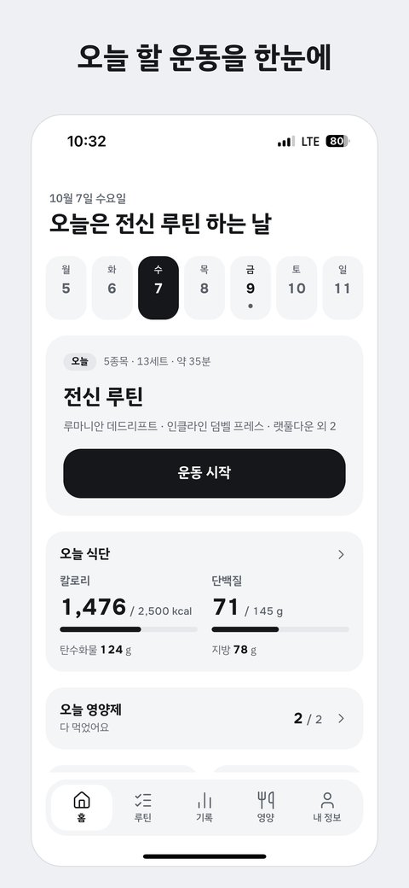
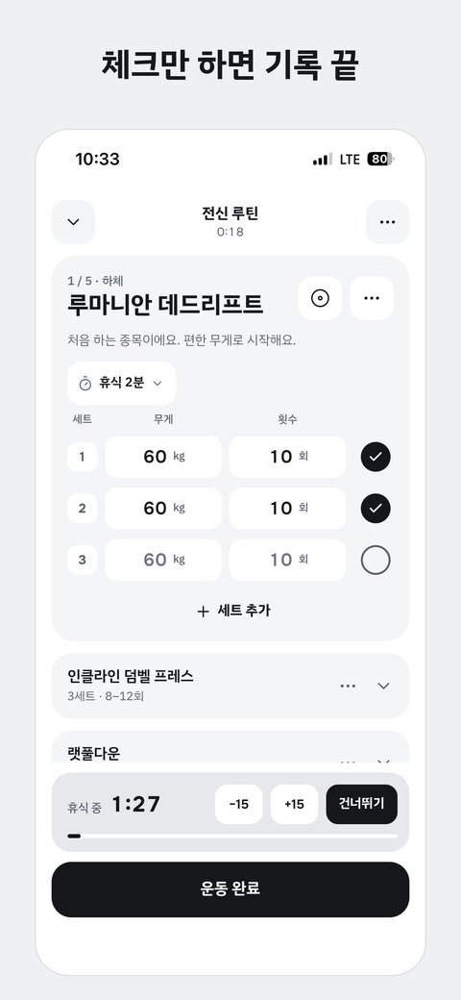
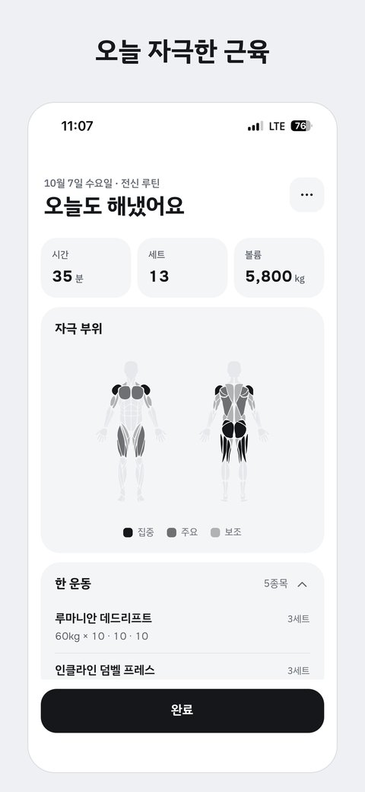
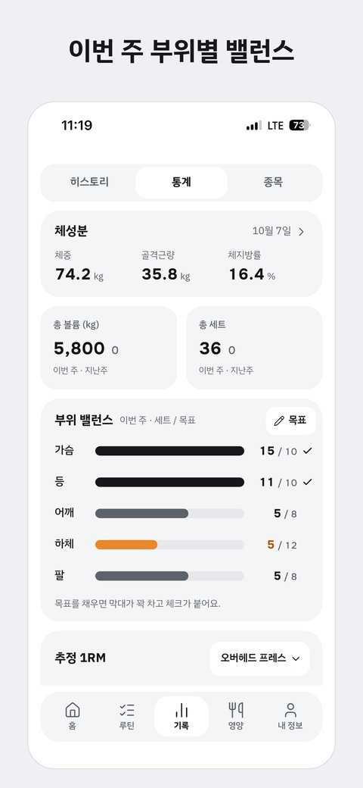
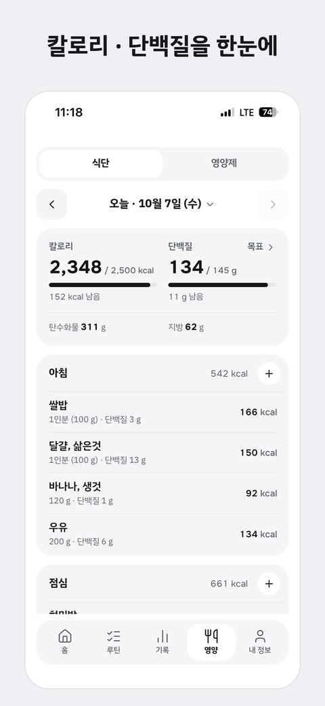
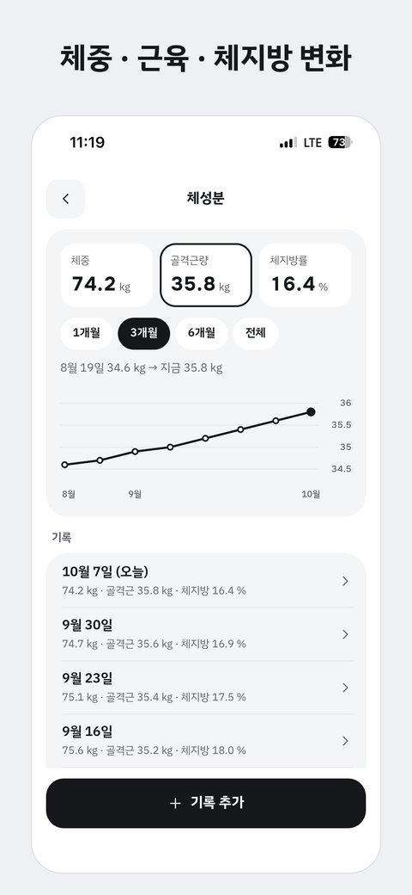
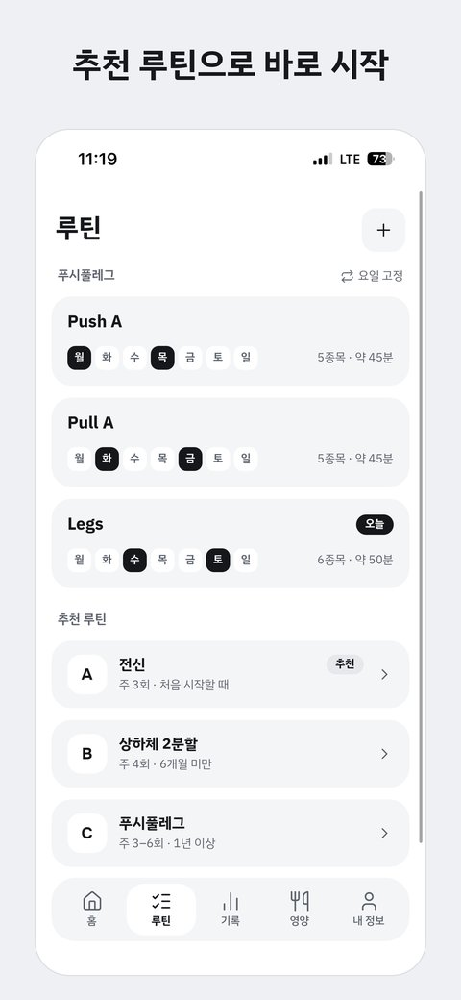
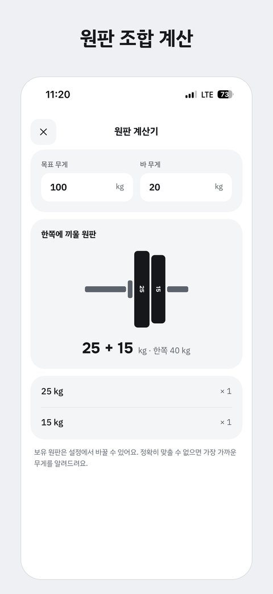
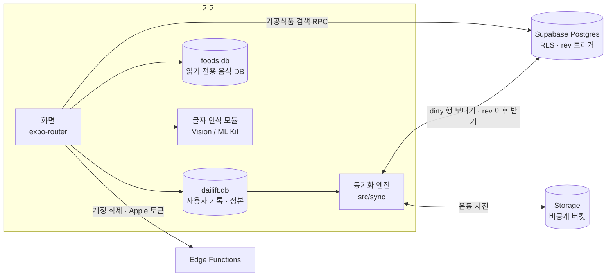

# Dailift

**운동 · 식단 · 체성분을 한곳에 기록하는 모바일 앱** — 로그인 없이 바로 쓰고, 계정을 연결하면 백업 · 동기화됩니다.

[](https://github.com/dohun1214/dailift/actions/workflows/ci.yml)
[](https://apps.apple.com/app/id6816855441)


| | |
|---|---|
| **상태** | App Store 출시 (1.0, 2026-10-19) · 실제 사용자 있음 · 1.1.0 심사 중 · Google Play 준비 중 |
| **기간** | 2026-09-22 첫 커밋 → 2026-10-19 출시 (약 4주) |
| **인원** | 1인 (기획 · 디자인 · 개발 · 테스트 · 출시 · 운영) |
| **플랫폼** | iOS · Android (React Native) / 한국어 · English / 라이트 · 다크 |
| **규모** | 화면 30개 · TypeScript 약 41,000줄 · 테스트 455개(58개 파일) 통과 · 이슈/PR 기반 79번 병합 |

<p align="center">
  
  
  
  
</p>
<p align="center">
  
  
  
  
</p>

---

## 목차
1. [왜 만들었나](#1-왜-만들었나)
2. [주요 기능](#2-주요-기능)
3. [기술 스택](#3-기술-스택)
4. [구조](#4-구조)
5. [설계 결정과 이유](#5-설계-결정과-이유)
6. [트러블슈팅](#6-트러블슈팅)
7. [품질 관리와 개발 방식](#7-품질-관리와-개발-방식)
8. [한계와 다음 계획](#8-한계와-다음-계획)
9. [실행 방법](#9-실행-방법)

---

## 1. 왜 만들었나

헬스장에서 운동 기록 앱, 식단 앱, 체성분 기록을 따로 쓰면 하루를 한눈에 보기 어렵습니다. Dailift는 **세 가지를 한 앱에서**, 그리고 **운동 중에 손이 덜 가게** 만드는 것을 목표로 했습니다.

- 운동 중에는 지난번 무게 · 횟수가 미리 채워져 있어서 **체크만 하면 기록이 끝나도록**
- 헬스장 지하처럼 인터넷이 안 되는 곳에서도 멈추지 않도록 **오프라인 우선**
- 회원가입이 부담스러운 사람도 바로 쓰도록 **게스트로 시작**, 원할 때만 계정 연결

개발자 본인이 실제로 운동하면서 TestFlight 빌드를 쓰고, 불편한 점을 이슈로 만들어 고치는 방식으로 다듬었습니다.

## 2. 주요 기능

**운동 기록**
- 요일별 루틴 · 루틴 묶음(프로그램), 추천 루틴 복사 / 세트별 무게 · 횟수 고정 또는 범위로 계획
- 운동 중: 지난 기록 자동 채우기, 증량 제안, 휴식 타이머, 워밍업 · 드롭 · 실패 세트, RPE, 원판 계산기
- **잠금 화면 · 다이내믹 아일랜드에 휴식 타이머**(iOS Live Activity), 안드로이드는 직접 만든 네이티브 모듈로 알림창 카운트다운
- 유산소: 스톱워치 / 타이머, 거리 · 속도 · 경사
- 지난 날 기록 추가, 운동을 끝내면 "오늘 한 대로 루틴을 바꿀까요?" 제안

**진행 확인**
- 종목별 최고 무게 · 추정 1RM(Epley, 신뢰 가능한 반복 범위에서만) 신기록
- 부위별 주간 목표 세트와 밸런스, 종목별 기록 추이 그래프
- 운동 요약에서 오늘 자극한 근육을 근육맵으로 표시

**식단 · 영양제 · 체성분**
- 음식 검색: 앱에 넣은 음식 DB 20,074개(식약처 · USDA) + 서버의 가공식품(식약처 31만 개, 미국 포장 제품 38만 개)
- 한글 **초성 검색**("ㅂㅊ" → 벤치프레스), 자주 먹는 음식 세트, 단백질 · 칼로리 목표
- **영양성분표 · 체성분 검사 결과지를 사진으로 찍으면 값을 읽어 채움** — 기기 안에서 글자 인식(iOS Vision, 안드로이드 ML Kit), 사진은 서버로 보내지 않음
- 영양제 복용 체크 · 로컬 알림(안 먹었으면 1시간 뒤 한 번 더)

**데이터**
- 게스트는 기기에만 저장, Apple · Google 로그인 시 백업 · 다른 기기와 동기화
- 식단 · 체성분은 **건강 데이터 동의를 따로 받았을 때만** 서버에 저장
- CSV · JSON 내보내기, 앱 안에서 계정 삭제(서버 데이터와 Apple 로그인 연결까지 해제)

## 3. 기술 스택

| 영역 | 사용 기술 |
|---|---|
| 앱 | React Native 0.86 · Expo SDK 57 · React 19 · TypeScript(strict, `noUncheckedIndexedAccess`) |
| 화면 · 상태 | expo-router(타입 있는 라우트) · zustand · react-native-unistyles 3(테마 6개) · Reanimated 4 · Gesture Handler |
| 기기 DB | expo-sqlite + drizzle-orm(마이그레이션 11개) |
| 서버 | Supabase — Postgres(RLS, 트리거), Storage, Edge Functions(Deno), Auth(Apple · Google) |
| 네이티브 | 직접 만든 Expo 모듈 2개: 글자 인식(Swift · Kotlin), 안드로이드 휴식 타이머 알림(Kotlin) / expo-widgets로 Live Activity |
| 다국어 | i18next — ko · en 키 구조가 같은지 테스트로 검사 |
| 품질 | Jest(jest-expo, better-sqlite3 인메모리 DB) · Biome · tsc · GitHub Actions |
| 배포 | EAS Build · EAS Submit · EAS Update(심사 없는 JS 수정본) · App Store Connect API 스크립트 |

## 4. 구조



```
src/
├─ app/          화면 (expo-router 파일 라우팅)
├─ components/   화면 조각 · 공통 UI(ui/)
├─ domain/       순수 계산 — 1RM, 세트 계획, 통계, 결과지 · 성분표 해석 … (React 없음, 단위 테스트 중심)
├─ db/           스키마 · 쿼리 · 시드
├─ sync/         동기화 엔진 · 사진 · 서버 데이터 지우기
├─ food/         음식 DB 열기 · 검색
├─ lib/ stores/  기기 기능 래퍼 · zustand 스토어
modules/         직접 만든 네이티브 모듈 (text-recognition, rest-notification)
widgets/         iOS Live Activity (휴식 · 유산소)
supabase/        서버 마이그레이션 14개 · Edge Functions
docs/            기능 명세(spec.md) · 개발 가이드(development.md)
```

계산 로직은 `domain/`에 순수 함수로 모으고, 화면은 그 결과를 그리기만 하도록 나눴습니다. 그래서 1RM · 세트 계획 비교 · 결과지 해석 같은 핵심 규칙을 기기 없이 테스트할 수 있습니다.

## 5. 설계 결정과 이유

### 오프라인 우선 동기화 — 기기 SQLite가 정본
- **결정**: 모든 기록은 먼저 기기 DB에 쓰고, 서버는 복제본. 행마다 `dirty`(보낼 변경) · `updated_at` · `deleted_at`(툼스톤)을 두고, 서버 트리거가 전역 시퀀스로 `rev`를 매깁니다. 기기는 "마지막으로 받은 rev 이후"만 받습니다.
- **충돌 처리**: 마지막 수정이 이기는 방식(LWW). 서버 트리거가 더 오래된 `updated_at`의 쓰기를 무시하고, 기기는 아직 안 보낸 변경이 더 새로우면 자기 것을 유지합니다.
- **왜**: 헬스장은 인터넷이 약하고, 운동 기록은 한 사람이 주로 한 기기에서 쓰므로 실시간 협업용 복잡한 방식(CRDT 등)보다 단순한 LWW로 충분하다고 판단했습니다.
- **구현 포인트**: 원격 저장소를 `SyncRemote` 인터페이스로 추상화해서 테스트에서는 메모리 구현으로 동기화 시나리오를 검증합니다(`src/sync/engine.ts`).

### 게스트가 기본, 계정은 선택
- 로그인 없이 시작하면 기록은 기기에만 있습니다. 나중에 계정을 연결하면 기기 기록을 모두 올립니다.
- 기기에 **다른 계정의 기록이 남아 있는 상태**에서 로그인하면, 섞이지 않도록 "지우고 계속 / 로그아웃"을 먼저 묻습니다.

### 음식 DB를 둘로 나눔
- 자주 찾는 기본 음식 2만 개(3.6MB)는 **앱에 넣어** 오프라인에서도 몇 ms 안에 찾습니다. 전문 검색 색인(FTS)은 파일 크기 때문에 두지 않고 LIKE 검색으로 충분한지 측정해 결정했습니다.
- 가공식품 31만 개는 앱에 넣으면 64MB라 **서버 표 + trigram 색인 + 검색 함수(RPC)** 로 분리했습니다. 사용자 기록에는 DB 줄 번호가 아닌 `출처 + 출처 id`와 영양값 사본을 남겨 DB를 갈아 끼워도 기록이 깨지지 않게 했습니다.

### 결과지 · 성분표는 기기 안에서 읽기
- 건강 정보가 담긴 사진을 서버로 보내지 않으려고 OS 내장 글자 인식(Vision · ML Kit)을 감싼 네이티브 모듈을 만들었습니다.
- 인식 엔진마다 줄을 나누는 방식이 달라서, 줄 단위가 아니라 **항목 이름의 위치를 찾고 같은 높이 오른쪽의 숫자**를 고르는 방식으로 해석합니다. 확실하지 않으면 틀린 값 대신 빈 칸으로 둡니다(`src/domain/`의 결과지 · 성분표 해석 함수, 실제 인식 결과를 넣은 테스트 포함).

### 개인정보와 삭제
- 서버 표는 RLS로 본인 행만 읽고 쓸 수 있습니다. 지운 행은 내용을 비우고 id · 시각만 남깁니다.
- 계정 삭제는 Edge Function에서 Apple 로그인 토큰 해지(App Store 요구 사항) → 사진 파일 삭제 → 계정 삭제(데이터는 cascade) 순으로 처리합니다.

### 출시 뒤 수정은 심사 없이
- EAS Update로 JS만 바뀐 수정은 바로 내려보냅니다. 런타임 버전을 앱 버전에 묶어(`appVersion` 정책) **네이티브가 바뀐 버전에 옛 코드가 가지 않게** 했습니다. 네이티브 변경 · DB 마이그레이션은 스토어 빌드로만 냅니다.

## 6. 트러블슈팅

실기기(iPhone) 테스트에서 나온 문제를 원인까지 추적해 고친 기록입니다.

**① 사진 선택 창을 누르면 앱이 멈춤 (iOS)**
- 원인: 아래에서 올라오는 선택 창(RN Modal)이 닫히는 애니메이션 도중 카메라 화면을 띄우면 iOS가 둘을 함께 닫았습니다. Modal은 다른 Modal이 닫히는 중이면 아예 뜨지 못하고 `visible`만 true로 남기도 했습니다.
- 해결: 창이 완전히 닫힌 뒤 실행하는 `afterClose`를 공통 부품에 넣고, 기기 화면(카메라 · 공유)과 앱 창의 이어 띄우기 간격을 규칙으로 정했습니다.

**② 다른 계정으로 바꿨는데 옛 기록이 화면에 남음**
- 원인: 조건 없는 `DELETE`는 SQLite가 표를 통째로 비우는 최적화를 써서 **변경 알림을 보내지 않습니다.** 그래서 DB는 비었는데 화면이 갱신되지 않았습니다.
- 해결: `WHERE 1 = 1`을 붙여 한 줄씩 지우게 해 변경 알림이 나가도록 했습니다.

**③ 통계를 연 채 운동을 마치면 수치가 안 바뀜**
- 원인: drizzle의 `useLiveQuery`는 `FROM` 표 하나만 지켜봅니다. 운동을 마치면 `workouts`만 바뀌고 `sets`는 그대로라 조인 쿼리가 다시 돌지 않았습니다.
- 해결: 조인한 표들의 변경 번호를 의존성으로 넣는 `useTableRev` 훅을 만들고, 조인 쿼리에는 항상 쓰도록 규칙화했습니다.

**④ 입력칸을 누르면 아래 버튼이 키보드 위로 잠깐 보였다 사라짐 (iOS)**
- 첫 시도(포커스 순간에 버튼 교체)는 효과가 없었습니다. 원인은 iOS에서 **키보드 이벤트가 포커스 이벤트보다 먼저 JS에 도착**하는 순서 문제였습니다.
- 해결: 타이밍을 맞추는 대신 버튼을 KeyboardAvoidingView 밖으로 옮겨, 키보드가 그대로 덮도록 배치 자체를 바꿨습니다.

**⑤ "다른 계정 기록이 사라졌다"는 제보 — 추측 대신 로그로 재진단**
- 처음에는 안내 창이 뜨지 못한 버그로 보고 고쳤지만, Supabase 요청 로그를 사용자 · 세션별로 시간순으로 맞춰 보니 **버그가 아니라 같은 계정 재로그인과 전체 삭제가 이어진 결과**였습니다(Apple과 Google 로그인은 서로 다른 계정).
- 이후 동기화 문제는 서버 요청 로그부터 확인하는 것을 규칙으로 정했습니다.

**⑥ 끌어서 순서를 바꾸면 옛 순서가 한 프레임 보임**
- UI 스레드의 위치 값을 푸는 시점과 DB → 라이브 쿼리로 새 순서가 오는 시점이 어긋났습니다. 화면 녹화를 프레임 단위로 나눠 확인한 뒤, 새 순서로 그릴 때 행을 새로 만들어(key에 epoch) 한 번에 바뀌게 했습니다.

## 7. 품질 관리와 개발 방식

- **흐름**: 이슈 → `feat/<번호>-<이름>` 브랜치 → PR → CI 통과 → squash merge. 한국어 conventional commits.
- **CI**: PR마다 Biome(린트) · `tsc`(타입) · Jest 실행.
- **테스트**: 순수 로직(계산 · 해석 · 동기화)은 단위 테스트, DB 로직은 better-sqlite3 인메모리 DB에 **실제 마이그레이션을 적용**해서 테스트합니다.
- **디자인 먼저**: 새 기능 · 수정은 시안을 먼저 만들고 승인한 뒤 개발했고, 구현 화면은 에뮬레이터 스크린샷을 시안과 나란히 놓고 맞췄습니다.
- **실기기 검증 루프**: TestFlight 빌드를 실제 운동에 쓰며 피드백 → 이슈 → 수정 → 확인 목록을 만들어 다음 빌드에서 재확인. 무료 빌드 횟수(월 15회)를 아끼려고 빌드 전 전체 점검을 따로 했습니다.
- **범위 조정**: 커뮤니티 기능은 출시 후로 미루고, 직접 매일 쓰는 식단 · 체성분 기록은 첫 출시에 넣는 식으로 실제 사용 경험을 기준으로 출시 범위를 정했습니다.

## 8. 한계와 다음 계획

**알고 있는 한계**
- 여러 기기가 같은 순간에 쓰면 rev 순서 때문에 드물게 한 번 놓칠 수 있음(다음 동기화에서 받음) → 커서를 조금 겹쳐 받는 방식으로 보완 예정
- 같은 계정을 두 기기에서 쓰면 다른 기기의 진행 중인 운동이 함께 보임
- Apple 로그인과 Google 로그인은 서로 다른 계정(계정 연결 기능 없음)

**다음 계획**
- Google Play 출시(비공개 테스트 진행 필요)
- 바코드 검색, JSON 백업 불러오기, 눈바디 사진 비교, 종목 자세 이미지

## 9. 실행 방법

```bash
npm install
npm run android     # Android 에뮬레이터 (개발 빌드 필요)
npm run lint        # Biome
npm run typecheck   # tsc --noEmit
npm test            # Jest
```

자세한 개발 절차와 기능별 구현 설명은 [`docs/development.md`](./docs/development.md), 화면별 기능 명세는 [`docs/spec.md`](./docs/spec.md)에 있습니다.

---

**데이터 출처**: 식품의약품안전처 식품영양성분 DB(공공데이터포털), USDA FoodData Central(CC0) · 근육맵 그림 react-native-body-highlighter(MIT)

**만든 사람**: 박도훈 · [dhp137qkr@gmail.com](mailto:dhp137qkr@gmail.com) · [개인정보 처리방침](https://dohun1214.github.io/dailift/privacy.html)
